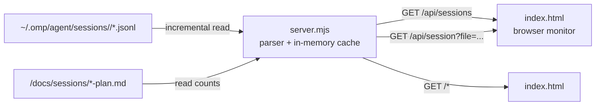

# OMP Live architecture

## 1. System boundary



No edge writes back to JSONL or plan files.

## 2. Runtime components

### `server.mjs`

Dependency-free Node HTTP server responsible for:

- Discovering session files under `OMP_SESSIONS_DIR` or `~/.omp/agent/sessions`.
- Incrementally parsing appended JSONL.
- Maintaining one in-memory state per session file.
- Deriving bounded events, pending calls, usage, todo and status.
- Reading `*-plan.md` checkbox counts from the selected session's workspace.
- Serving JSON APIs and `index.html`.

### `index.html`

A standalone document containing:

- Theme bootstrap, CSS and semantic HTML.
- API polling and session selection.
- Rendering and state inference.
- Agent Workflow SVG and animation lifecycle.
- Live Trace rendering from the session snapshot.
- Process Guides data, SVG renderer and controls.

Live Trace is derived during the same incremental parse and returned inside the existing session snapshot. It does not introduce a second file reader, database or telemetry source.

External runtime dependency: Google Fonts for JetBrains Mono. The system fallback remains usable without it.

## 3. Configuration

| Variable | Default | Contract |
|---|---|---|
| `OMP_SESSIONS_DIR` | `~/.omp/agent/sessions` | Root containing one directory level of workspace/session groups and JSONL files |
| `PORT` | `4873` | HTTP port; server still binds only to `127.0.0.1` |

Internal bounds:

| Constant | Value | Meaning |
|---|---:|---|
| `ACTIVE_WINDOW_MS` | 25,000 ms | Recent activity threshold for `working` when no call is pending |
| `EVENT_LIMIT` | 60 | Maximum retained event objects per cached session |
| `SNAPSHOT_EVENTS` | 60 | Maximum events returned to the browser |

## 4. Incremental parser

Each cached session state stores:

- File path, byte offset and incomplete-line remainder.
- Session identity and metadata.
- Counts, usage and context snapshot.
- Pending tool executions and bounded event history.
- Todo phases, task calls, errors and last role.
- Deduplication sets for events and response usage.

Read algorithm:

1. Stat the file.
2. If size shrank, reset state for that file.
3. If unchanged, do nothing.
4. Read bytes from the previous offset.
5. Prefix the prior incomplete remainder.
6. Parse complete newline-delimited records.
7. Keep the final incomplete line as the next remainder.
8. Ignore malformed complete lines rather than terminating the monitor.

## 5. Recognized JSONL records

| Record | Effect |
|---|---|
| `session` | Set id, cwd, start time and initial title |
| `title`, `title_change` | Update title |
| `model_change` | Update model id |
| `thinking_level_change` | Update thinking level |
| `compaction` | Increment compaction count |
| `custom/tool_execution_start` | Add pending call with tool, intent, start time and clipped args |
| `custom/todo_hud_state` | Update todo visibility |
| `custom/session_exit` | Mark ended |
| `message/user` | Count prompt, save clipped text, add user event, clear ended |
| `message/assistant` | Count turn, aggregate usage once per response id, update context and tool-call events |
| `message/toolResult` | Resolve pending call, duration, error/task status, todo result and result event |

Unknown record types are ignored.

## 6. Status derivation

Priority:

1. `ended` when a session-exit record has been observed and no later user message cleared it.
2. `working` while any tool execution is pending.
3. `working` when the newer of last parsed timestamp and file mtime is within 25 seconds.
4. Otherwise `idle`.

This is a monitor heuristic, not an execution-state protocol.

## 7. Event model

Events are bounded and deduplicated by id: `user`, `call`, `result`, and `reply`. Calls include tool, intent, time, state and lane. Results include finish time, duration and error flag. When the 60-event bound is exceeded, the oldest event and matching call index are removed.

## 8. Live Trace model

Trace records are bounded to 80 and deduplicated by stable id. They are generated only from observed JSONL records:

| Trace kind | Source |
|---|---|
| `session-start`, `session-end` | `session`, `custom/session_exit` |
| `prompt`, `reply` | User message, assistant message without tool calls |
| `tool-start` | `custom/tool_execution_start` |
| `tool-end`, `tool-error` | Tool result paired by `toolCallId` |
| `model`, `thinking` | Model/thinking change records |
| `compaction` | Compaction record |
| `todo`, `todo-visibility` | Successful todo result, todo HUD state |

Tool start uses execution start rather than the earlier assistant `toolCall` proposal. The `trace` snapshot field is oldest-first; the browser reverses it for display. Context assembly, reasoning, Verify and internal retry are absent because no corresponding records exist.

## 9. HTTP API

All responses include `cache-control: no-store`.

### `GET /api/sessions`

Returns up to 30 newest sessions with `file`, `title`, `cwd`, `mtime`, and `status`.

### `GET /api/session`

Without `file`, resolves the newest session. With `file`, validates and snapshots that exact file.

```text
file, now, status, id, title, cwd, model, thinking,
startedAt, lastAt, userCount, assistantTurns,
lastUser, lastAssistant, usage, context, compactions,
errors, toolCounts, pending, todo, todoVisibility,
lastRole, events, trace, tasks, plans
```

Returns `404 {"error":"no session found"}` when no valid session resolves. Other paths return `index.html`.

## 10. File request safety

A requested session file is accepted only when its resolved path is under the session root, ends with `.jsonl`, and exists. The API returns absolute paths because the browser sends one back for explicit local selection.

## 11. Browser polling and rendering

- Current session: every 300 ms; session list: every 4 seconds; clock: every second.
- Workflow stage/context illustration check: every 100 ms.
- Session polling is single-flight and stale selection responses are ignored.
- `setSlot` caches markup and preserves scroll position.
- Workflow SVG remains mounted until the `<520px` topology breakpoint changes.

## 12. Trust and privacy

- Loopback-only is the security boundary; no authentication exists.
- Dynamic JSONL text is untrusted and MUST be HTML-escaped.
- Prompt/reply text, tool arguments, paths, usage and costs may be sensitive.
- The server does not redact secrets. Do not expose the port remotely.

## 13. Change rules

- Ground new JSONL assumptions in observed records and remain backward-tolerant.
- API changes require matching product, UI and browser-consumer updates.
- Never style inferred stages as observed without a real parser path.
- Preserve bounded memory and incremental reads.
- Avoid adding a framework/build chain without a demonstrated requirement.
