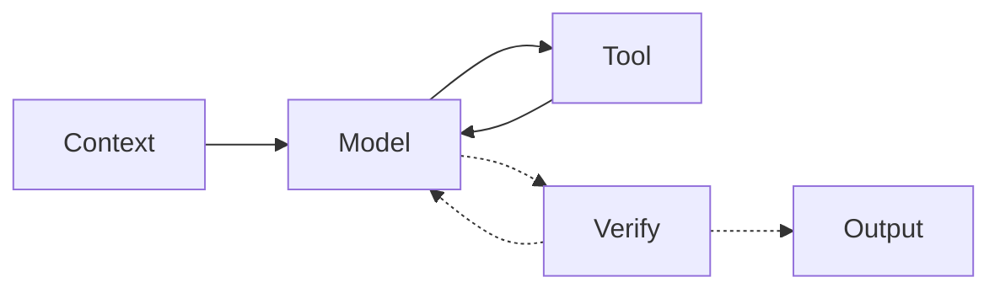

# OMP Live UI and state specification

## 1. Information hierarchy

1. Header: product identity, selected session, workspace/model, clock, Guides and theme.
2. Status strip: seven compact operational metrics.
3. Main: Three balanced equal-width panels: Agent Workflow, Live Trace (observed workflow graph), and Tool Calls (filterable recent executions).
4. Bottom: Sessions, Conversation, Todo and Session metadata.
5. Modal layer: Process Guides.

The monitor SHOULD prioritize current work above history. Panels use their own scrolling instead of expanding desktop document height.

## 2. Visual system

- Typography: JetBrains Mono, then system monospace.
- Canvas: 32px grid; dark theme additionally uses fixed radial blue glows.
- Panels: low-radius translucent surfaces, subtle border, lime left accent.
- Accent: dark `#b6ff6a`; light `#4d7c0f`.
- Status colors remain semantically independent: success, running and error.
- Selected controls use solid accent; selection MUST NOT imply runtime activity.

## 3. Agent Workflow topology

Observed/schematic topology:

- Solid paths: relationships grounded in session records.
- Dashed paths: inferred or schematic relationships.
- Desktop: Context left; Tool above Model; Verify below Model; Output right of Verify.
- Mobile: Tool, Model, Verify and Output share a vertical axis; Context enters Model from the left.
- The SVG has five keyboard-selectable node groups and six non-crossing orthogonal paths.

## 4. Runtime truth table

| Stage | Activation rule | Evidence class | Required label |
|---|---|---|---|
| Context | Working, no pending call, latest role user, within six-step 4.5s illustration window | Inferred | `prompt + instructions`; detail says illustration, not telemetry |
| Model | Working fallback; recent user after Context window; tool result/other activity without stronger state | Inferred | `activity inferred` |
| Tool | Any pending call or latest role is assistant tool call | Observed | `observed calls`; running badge from pending call |
| Verify | Never automatically selected by current session data | Schematic | `schematic` |
| Output | Latest role is assistant text while working | Observed reply | `reply observed` |

When the session is not working, no node is active.

## 5. Workflow interaction

- Click, Enter or Space selects a node and expands its detail.
- Manual selection persists until a genuinely changed auto-active stage supersedes the previously auto-selected stage.
- Detail starts collapsed but never disappears; collapsed state shows selected-stage summary.
- Context detail lists six conceptual inputs and has `Replay illustration`.
- Replay advances one step per 750 ms and MUST be labeled illustrative.
- Tool detail lists every pending call and elapsed time.
- Verify detail explicitly says no live Verify event exists.

## 6. Workflow motion

### Ambient active state

- Active node breathes `scale(1 → 1.055 → 1)` over 1.6 seconds.
- Card accent/stroke and dashed halo share the beat.
- Only an active node shows its halo.

### Tool state

- Pending tool: accent card, `RUNNING <duration>` badge, live Model→Tool edge.
- Recent result (<3 seconds): success or failure card/badge without claiming Running.
- Tool subtitle changes to `RUNNING NOW` only while pending.

### Handoffs

Handoffs are event-triggered one-shot sequences, not continuous decoration:

| Transition | Pulse route |
|---|---|
| Context → Model | Context → Model |
| Context → Tool | Context → Model → Tool |
| Model → Tool | Model → Tool |
| Tool → Model | Tool → Model |
| Tool → Output | Tool → Model → Verify → Output |
| Model → Output | Model → Verify → Output |
| Verify → Model | Verify → Model |
| Verify → Output | Verify → Output |

A new sequence cancels the old sequence. Responsive SVG rebuild and session switching also cancel it. Reduced motion skips pulses.

## 7. Tool Calls semantics

- Rows are newest first.
- `All` includes call, user and reply events from the recent window.
- Running/Error filters include matching call events only.
- Header count is `last <retained call count> of <total tool count> calls`.
- Running rows: cyan-tinted fill, 3px left border, spinner, bold text/duration and bottom progress streak.
- Spinner and streak phase derive from wall-clock elapsed modulo 1100 ms so 300 ms DOM updates do not visibly restart them.
- Fresh event entry MAY use a brief vertical pop.

## 8. Live Trace semantics

- Live Trace is rendered as a standalone balanced panel in the main section between Agent Workflow and Tool Calls.
- Redundant raw timeline is omitted in favor of the dedicated Tool Calls panel; Live Trace focuses exclusively on the observed workflow graph (Prompt → Tool ⇄ Todo → Reply).
- Node states reflect live execution (active pulsing highlight, error state, and edge directional indicators).

## 9. Responsive contract

| Width | Layout |
|---|---|
| ≥1100px | Fixed one-screen app grid; three balanced 1fr panels (Agent Workflow, Live Trace, Tool Calls); four bottom panels |
| 761–1099px | Stacked main panels (height 400px each); bottom two columns; status 4+3 |
| ≤760px | Single-column stack; header without clock; status two columns; tool name column hidden |

Desktop `.app` height is `100vh`. Mobile uses natural document scrolling.

Agent Workflow changes topology below a measured container width of 520px, independent of the page media query.

## 10. Process Guides

### Shared state

- `guideIndex`: active guide.
- `guideStep`: active step.
- `guidePlaying`: autoplay state.
- Step duration: 3600 ms.
- Opening defaults to autoplay unless reduced motion is requested.
- Closing clears the timer and returns focus to the Guides button.
- While open, the dashboard `.app` is inert.

### Highlight semantics

- Current step: full opacity, accent shapes/edges, node breathe and edge pulse.
- Earlier steps: 70% opacity.
- Future steps: 22% opacity.
- Edge labels follow the same current/seen states.

### Guide inventories

| ID | Nodes | Edges | Steps |
|---|---:|---:|---:|
| `harness` | 15 | 14 | 5 |
| `rag` | 18 | 17 | 7 |
| `wiki` | 14 | 14 | 11 |

Every step id MUST resolve to an existing node/edge. The authored SVG viewBox MUST contain every node and text label.

### Mobile

At ≤760px, legend is hidden and the diagram has minimum width 720px inside `.gstage`, which owns horizontal scrolling. The modal panel and document remain viewport-contained.

## 11. Theme and persistence

- Initial theme: local-storage preference; otherwise OS light preference; otherwise dark.
- Toggle persists `omp-live-theme` when storage is available.
- Meta theme color updates with the active theme.
- Theme changes MUST preserve state, selection and guide step.

## 12. Accessibility requirements

- Interactive workflow nodes have `role=button`, `tabindex=0` and descriptive `aria-label`.
- Pressed filters/tabs expose `aria-pressed`.
- Active guide dot exposes `aria-current=step`.
- Detail toggle exposes `aria-expanded` and `aria-controls`.
- Guide root uses `role=dialog`, `aria-modal=true` and a labelled heading.
- Focus-visible outline remains present in both themes.
- Escape closes Guides; Left/Right advances steps.
- Reduced motion disables all CSS animation/transition and guide autoplay.

Known limitation: the guide dialog sets the background inert and focuses Close, but does not implement a full Tab focus trap.

## 13. Copy rules

- Dashboard runtime labels remain English.
- Never remove `inferred`, `schematic`, `illustrative` or `not telemetry` qualifiers where specified.
- Cost says `(as logged by OMP)`; the viewer does not recompute it.
- Process Guide source attribution and non-telemetry label remain visible.
- `Setup của bạn` comparison notes may be Vietnamese because they answer the user's local setup question; identifiers and products remain exact.
